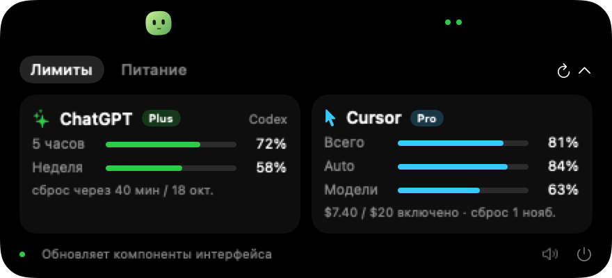
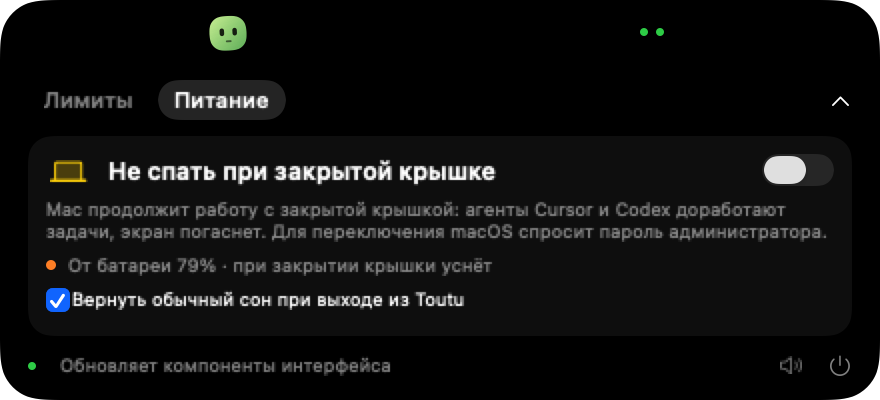

<div align="center">

# 🍃 TouTou

**Компаньон в вырезе MacBook для тех, кто работает с ИИ‑агентами.**<br>
Остатки лимитов ChatGPT и Cursor, живые события агента и Mac, который не засыпает с закрытой крышкой — всё в одной панели у камеры.

[](#требования)
[](Package.swift)
[](Sources/Toutu)
[](Package.swift)
[](LICENSE)
[](https://github.com/TemDakar/TouTou/actions/workflows/ci.yml)
[](https://github.com/TemDakar/TouTou/releases)



<sub>Данные на скриншотах демонстрационные (<code>TOUTU_DEMO=1</code>).</sub>

</div>

> **English:** Toutu is a native macOS notch companion for AI‑agent workflows. It shows real remaining quotas for ChatGPT (Codex) and Cursor, live Cursor agent events via hooks, and can keep your MacBook awake with the lid closed so agents finish their work. No dependencies, no telemetry, no tokens stored. UI is in Russian.

---

## Содержание

- [Что умеет](#что-умеет)
- [Быстрый старт](#быстрый-старт)
- [Требования](#требования)
- [Установка](#установка)
- [Подключение Cursor](#подключение-cursor)
- [Лимиты ChatGPT и Cursor](#лимиты-chatgpt-и-cursor)
- [Вкладка «Питание»](#вкладка-питание)
- [Как устроена панель](#как-устроена-панель)
- [Приватность](#приватность)
- [Потребление ресурсов](#потребление-ресурсов)
- [Решение проблем](#решение-проблем)
- [Разработка](#разработка)
- [Дорожная карта](#дорожная-карта)
- [Участие и лицензия](#участие-и-лицензия)

---

## Что умеет

| | |
|---|---|
| 📊 **Реальные лимиты** | Cursor: те же две полосы, что в самом Cursor — «Cursor Models» и «Other Models» (процент использования). ChatGPT: 5‑часовое и недельное окна Codex с датой сброса у каждой полосы, тариф, кредиты. |
| 🤖 **События агента** | Cursor hooks сообщают: сессия началась, агент работает, файл обновлён, ответ готов, задача завершена, инструмент упал. Звук завершения — отключаемый. |
| 🌙 **Без сна с закрытой крышкой** | Один переключатель — и MacBook продолжает работать без внешнего монитора, пока агенты доделывают задачи. Честно показывает источник питания и заряд. |
| 🟢 **Персонаж** | Зелёный компаньон живёт в полосе выреза, кивает, пока агент работает, и замирает, когда делать нечего — ради батареи. |
| 🔒 **Ничего лишнего** | Без зависимостей, телеметрии и сохранённых токенов. Один бинарник, один Python‑скрипт, всё читается в исходниках за вечер. |
| 🔋 **Лёгкий** | 0,0 % CPU и 17 МБ в простое. Подробности и методика — [ниже](#потребление-ресурсов). |

<div align="center">

</div>

---

## Быстрый старт

```bash
git clone https://github.com/TemDakar/TouTou.git
cd TouTou
bash scripts/build.sh          # соберёт dist/Toutu.app
open dist/Toutu.app            # панель появится у выреза камеры

# Подключить события Cursor (по желанию)
python3 scripts/configure_cursor.py
python3 scripts/install_cursor.py --user
```

Наведите курсор на вырез камеры — панель раскроется. Значок 🍃 в строке меню скрывает и показывает её.

---

## Требования

| Компонент | Зачем | Обязательно |
|---|---|---|
| macOS 13 Ventura или новее | SwiftUI API панели | Да |
| Xcode (или Command Line Tools) с принятой лицензией | Сборка и `/usr/bin/python3` | Для сборки |
| [Cursor](https://cursor.com) | Лимиты Cursor и события агента | Нет |
| [ChatGPT для macOS](https://chatgpt.com/download) с Codex | Лимиты ChatGPT / Codex | Нет |
| MacBook с вырезом камеры | Панель встаёт точно в вырез | Нет — на других экранах панель у верхнего края по центру |

Без Cursor или ChatGPT соответствующая карточка покажет «Нет данных — проверь вход и сеть», остальное работает.

---

## Установка

### Вариант A — готовая сборка

1. Скачайте `Toutu-vX.Y.Z.zip` со страницы [**Releases**](https://github.com/TemDakar/TouTou/releases) и распакуйте.
2. Перетащите `Toutu.app` в `Программы` (необязательно, можно запускать откуда угодно).
3. Первый запуск: сборка подписана ad‑hoc и не нотаризована, поэтому macOS покажет предупреждение. Нажмите правой кнопкой → **Открыть** → **Открыть**, либо снимите карантин:

   ```bash
   xattr -dr com.apple.quarantine /Applications/Toutu.app
   ```

### Вариант B — собрать самостоятельно

```bash
sudo xcodebuild -license accept   # один раз, если Xcode только что установлен
git clone https://github.com/TemDakar/TouTou.git && cd TouTou
bash scripts/build.sh
open dist/Toutu.app
```

Скрипт выполняет `swift build -c release`, собирает бандл `dist/Toutu.app`, кладёт `fetch_usage.py` в `Contents/Resources` и подписывает ad‑hoc.

### Автозапуск при входе

На вкладке «Питание» включите **«Открывать Toutu при включении Mac»**. Если система попросит подтверждение, разрешите Toutu в **Системные настройки → Основные → Объекты входа**. Приложение не показывается в Dock и живёт только в строке меню и у выреза.

---

## Подключение Cursor

Toutu узнаёт о событиях агента через официальные [Cursor hooks](https://prod.cursor.com/docs/hooks). Hooks только **наблюдают** — все разрешения и подтверждения остаются в Cursor.

```bash
# 1. Сгенерировать конфигурацию с абсолютными путями к Python и адаптеру
python3 scripts/configure_cursor.py        # → cursor-hooks.json

# 2. Объединить с вашими hooks (сохраняется резервная копия)
python3 scripts/install_cursor.py --user   # → ~/.cursor/hooks.json
#   без --user установится только в .cursor/hooks.json этого проекта

# 3. Перезапустить Cursor или начать новую Agent‑сессию
```

Подписка идёт на `sessionStart`, `sessionEnd`, `beforeSubmitPrompt`, `afterShellExecution`, `afterFileEdit`, `afterAgentResponse`, `stop`, `postToolUseFailure`.

> [!NOTE]
> `cursor-hooks.json` содержит абсолютные пути и исключён из репозитория. Если переместили проект или сменили Python — запустите генератор заново и переустановите hooks.

События пишутся в `~/Library/Application Support/Toutu/events`: один JSON на сессию, атомарная запись, автоудаление старше суток. Сохраняются только путь проекта / файла, статус и время — **никаких промптов, ответов, содержимого файлов и вывода команд**. Переменная `TOUTU_DATA_DIR` меняет папку и для приложения, и для адаптера.

---

## Лимиты ChatGPT и Cursor

Обновляются каждые 5 минут (10 — от батареи), при раскрытии панели, если данным больше 90 секунд, и по кнопке ↻. Пока спит экран, таймер стоит; скрытая значком 🍃 панель проверку не останавливает. Полоса показывает **остаток**; наведение — использовано/осталось с десятыми и точную дату сброса.

Когда остаток окна опускается до 25 % и затем до 10 %, Toutu показывает уведомление macOS с названием сервиса и окна («ChatGPT · 5 часов: осталось 8 %»). То же окно не повторяется, пока остаток снова не станет выше 25 % или не начнётся новый период сброса. Колокольчик внизу панели выключает предупреждения. При первом запуске система один раз спрашивает разрешение; баннер локальный, пушей нет. Демо-режим (`TOUTU_DEMO`) уведомления не шлёт.

### Cursor

| Строка | Источник | Что означает |
|---|---|---|
| **Cursor** | `autoPercentUsed` | Cursor Models: Composer, Grok, Auto. Тот же % использования, что в IDE |
| **Другие** | `apiPercentUsed` | Other Models: сторонние модели по цене API |
| `Сверх плана: $…` | `onDemand` | Показывается, только если on‑demand включён |
| Бейдж `Pro` | `membershipType` | Тариф |

Данные берутся из `GET https://cursor.com/api/usage-summary` с токеном из локальной базы Cursor (read‑only). Перенаправления запрещены, токен не логируется.

### ChatGPT / Codex

5‑часовое и недельное окна, тариф (`Plus`, `Pro`…), кредиты и флаги «Лимит исчерпан» / «Достигнут лимит расходов». Читается через установленный `codex app-server` вызовом `account/rateLimits/read` — новые чаты не создаются.

> [!IMPORTANT]
> Это лимиты **Codex / ChatGPT Work** из desktop‑приложения, а не счётчик сообщений обычного веб‑чата.

---

## Вкладка «Питание»

Переключатель **«Не спать при закрытой крышке»** решает классическую проблему: закрыли MacBook — агент остановился на середине задачи.

- Выполняет `pmset -a disablesleep 1` (и `0` при выключении). Это единственный способ в macOS работать с закрытой крышкой без внешнего монитора, он требует прав администратора, поэтому система показывает стандартный диалог с паролем при каждом переключении.
- Показывает фактическое состояние из `pmset -g`, источник питания и заряд (через IOKit, без опроса).
- При работе от батареи предупреждает оранжевым.
- Флажок **«Вернуть обычный сон при выходе из Toutu»** (по умолчанию включён) возвращает настройку при закрытии приложения.
- Пока режим активен, в компактной полосе горит значок луны.

> [!WARNING]
> Настройка общесистемная: пока она включена, Mac не уснёт **ни от бездействия, ни от закрытия крышки, ни от батареи**. Не кладите ноутбук в сумку с включённым режимом. Проверить и сбросить вручную:
> ```bash
> pmset -g | grep SleepDisabled
> sudo pmset -a disablesleep 0
> ```

---

## Как устроена панель

- **Прикреплена к вырезу.** Размеры выреза берутся из `NSScreen.auxiliaryTopLeftArea / auxiliaryTopRightArea`, верх панели совпадает с верхом экрана. На экране без выреза — центр верхнего края.
- **Компактный режим** — полоса шириной выреза + 64 pt: персонаж слева, индикаторы ChatGPT и Cursor справа (зелёный / оранжевый ≤ 25 % / красный ≤ 10 %).
- **Раскрытая панель** 440 × 200 pt: вкладки «Лимиты» и «Питание», нижняя строка с последним событием агента, колокольчиком предупреждений, звуком и выходом.
- **Анимация** раскрытия 0,32 с, сворачивания 0,26 с после задержки 0,6 с; повторное наведение продолжает движение с текущего размера. Учитывается системное «Уменьшить движение».
- Нажатие на «ChatGPT» или «Cursor» открывает соответствующее приложение.

---

## Приватность

Коротко: **ничего не сохраняется и никуда не отправляется, кроме запросов к вашим же аккаунтам.**

- Токены, cookie, email, идентификаторы и сырые ответы API не логируются и не пишутся на диск. При ошибке — «Нет данных», а не текст исключения.
- Hooks не читают промпты, ответы, файлы и вывод команд.
- Нет телеметрии, аналитики, автообновлений, сетевого сервера.
- Права администратора запрашиваются только для `pmset` и только через системный диалог.

Подробная таблица «что делает / чего не делает» и как сообщить об уязвимости — в [SECURITY.md](SECURITY.md).

---

## Потребление ресурсов

Приложение живёт в строке меню круглосуточно, часто от батареи, поэтому экономия — требование, а не опция.

| Состояние | CPU | Переключений контекста/с | Память |
|---|---|---|---|
| Простой | **0,0 %** | ~1 | **17 МБ** |
| Агент работает | 1–2 % | ~75 | 19–20 МБ |
| <sub>до оптимизации (любое состояние)</sub> | <sub>7–8 %</sub> | <sub>~300</sub> | <sub>45 МБ</sub> |

<sub>MacBook с Apple Silicon, release‑сборка, `top -pid $(pgrep -x Toutu)`.</sub>

Как это достигается:

- Персонаж **неподвижен** в простое, в компактной полосе при работе агента делает короткий кивок раз в 1,2 с (≈ 12 кадров/с), а непрерывная анимация включается только в раскрытой панели.
- События Cursor приходят через `DispatchSource` на папку с коалесцированием 0,15 с — без опроса. Одинаковое состояние не публикуется, чтобы не перерисовывать интерфейс.
- Самая дорогая операция — запуск `python3` + `codex app-server` — выполняется раз в 5 минут (10 от батареи) и ставится на паузу только при спящем экране. Скрытая панель проверку не останавливает: иначе уведомлению о низком лимите неоткуда взять цифры.
- Источник питания читается через `IOPSCopyPowerSourcesInfo` с системным уведомлением; `pmset -g` запускается только по необходимости.
- У всех таймеров есть `tolerance`, чтобы система объединяла пробуждения.

---

## Решение проблем

<details>
<summary><b>«Нет данных — проверь вход и сеть» у Cursor</b></summary>

- Войдите в Cursor (Settings → Account). Токен читается из `~/Library/Application Support/Cursor/User/globalStorage/state.vscdb`.
- Проверьте вручную: `python3 scripts/fetch_usage.py` — в выводе только проценты и даты.
- Токен Cursor имеет срок действия; откройте Cursor, чтобы он обновился.
</details>

<details>
<summary><b>«Нет данных» у ChatGPT</b></summary>

- Нужно desktop‑приложение ChatGPT с Codex и вход в аккаунт. Toutu ищет `codex` в `PATH` или по пути `/Applications/ChatGPT.app/Contents/Resources/codex-cli/.../codex`.
- Выполните в терминале `codex app-server` — если команда не найдена, Codex не установлен.
</details>

<details>
<summary><b>События Cursor не появляются</b></summary>

- Проверьте `~/.cursor/hooks.json` — там должны быть команды с `cursor_hook.py`.
- Начните **новую** Agent‑сессию: hooks подхватываются при старте сессии.
- Посмотрите папку `~/Library/Application Support/Toutu/events` — при работе агента там появляются JSON‑файлы.
- Если переносили проект — перегенерируйте `cursor-hooks.json` и переустановите.
</details>

<details>
<summary><b>Панель стоит не в вырезе / на внешнем мониторе</b></summary>

Toutu выбирает первый экран с вырезом, иначе — главный. Запустите `./.build/release/Toutu --screen-info`, чтобы увидеть, что сообщает система о ваших экранах, и приложите вывод к issue.
</details>

<details>
<summary><b>macOS не даёт открыть приложение</b></summary>

Сборка не нотаризована. Правая кнопка → **Открыть**, или `xattr -dr com.apple.quarantine /путь/к/Toutu.app`. Либо соберите сами — `bash scripts/build.sh`.
</details>

<details>
<summary><b>Mac не засыпает после удаления Toutu</b></summary>

Режим «Не спать» — системная настройка. Выполните `sudo pmset -a disablesleep 0`.
</details>

---

## Разработка

```bash
swift run                                   # запуск из исходников
swift build -c release                      # release‑бинарник в .build/release/Toutu
python3 -m unittest discover -s Tests -v    # тесты Python‑модулей
swift test                                  # пороги уведомлений о лимите

# Рендер раскрытой панели в PNG (обе вкладки) — удобно для проверки вёрстки и PR
TOUTU_DEMO=1 .build/release/Toutu --snapshot /tmp/panel   # демо‑данные
.build/release/Toutu --snapshot /tmp/panel                # ваши реальные данные

.build/release/Toutu --screen-info          # параметры экранов и выреза
```

| Переменная | Назначение |
|---|---|
| `TOUTU_DEMO=1` | Фиксированные демо‑лимиты и демо‑события; аккаунты не трогаются |
| `TOUTU_DATA_DIR` | Другая папка событий для приложения и адаптера hooks |

```
Sources/QuotaAlerts/
  QuotaAlerts.swift   когда слать уведомление о низком остатке
Sources/Toutu/
  main.swift      панель, персонаж, вкладки, AppDelegate
  Usage.swift     модель лимитов, запуск fetch_usage.py, демо‑данные
  Alerts.swift    баннер macOS и колокольчик в панели
  Power.swift     режим без сна, IOKit, pmset
scripts/
  fetch_usage.py        лимиты Cursor и ChatGPT / Codex
  cursor_hook.py        адаптер Cursor hooks → JSON‑события
  configure_cursor.py   генерация cursor-hooks.json
  install_cursor.py     слияние hooks с бэкапом
  build.sh              release‑сборка и бандл
Tests/                  unittest
docs/screenshots/       PNG для README
```

CI на GitHub Actions ([`.github/workflows/ci.yml`](.github/workflows/ci.yml)) собирает приложение, гоняет тесты и прикладывает `Toutu.app` и скриншоты к каждому запуску.

### Выпуск релиза

Релиз публикуется автоматически ([`.github/workflows/release.yml`](.github/workflows/release.yml)) при пуше тега вида `vX.Y.Z`:

```bash
# 1. Обновите версию в scripts/Info.plist и раздел в CHANGELOG.md, закоммитьте
# 2. Поставьте тег и отправьте его
git tag v0.3.0
git push origin v0.3.0
```

Через несколько минут на странице **Releases** появится `Toutu-v0.3.0.zip`, его SHA‑256 и заметки, взятые из соответствующего раздела `CHANGELOG.md`. Workflow откажется собирать релиз, если версия в теге не совпадает с `CFBundleShortVersionString` в `Info.plist`.

---

## Дорожная карта

- [ ] Нотаризованные сборки в Releases
- [ ] Поддержка Claude Code и других агентов через их hooks
- [x] Уведомление, когда лимит опускается ниже порога
- [ ] Автовключение режима без сна, пока агент работает (без повторного ввода пароля — через привилегированный helper)
- [ ] Локализация интерфейса (English)

Идеи и голоса — в Issues.

---

## Участие и лицензия

Pull request'ы приветствуются — см. [CONTRIBUTING.md](CONTRIBUTING.md). История изменений — в [CHANGELOG.md](CHANGELOG.md).

Код распространяется под лицензией [MIT](LICENSE).

### Благодарности

- Идея компаньона в вырезе — [CouCou](https://github.com/Louis-CFM/coucou). Код, персонаж и звуки не копировались; Toutu — самостоятельная реализация.
- [Cursor hooks](https://prod.cursor.com/docs/hooks), [ChatGPT app‑server](https://learn.chatgpt.com/docs/app-server).
- Справка по API дашборда Cursor — [CodexBar](https://github.com/steipete/CodexBar/blob/main/docs/cursor.md).

<div align="center">
<sub>Сделано для тех, кто запускает агента и уходит пить кофе. 🍃</sub>
</div>
